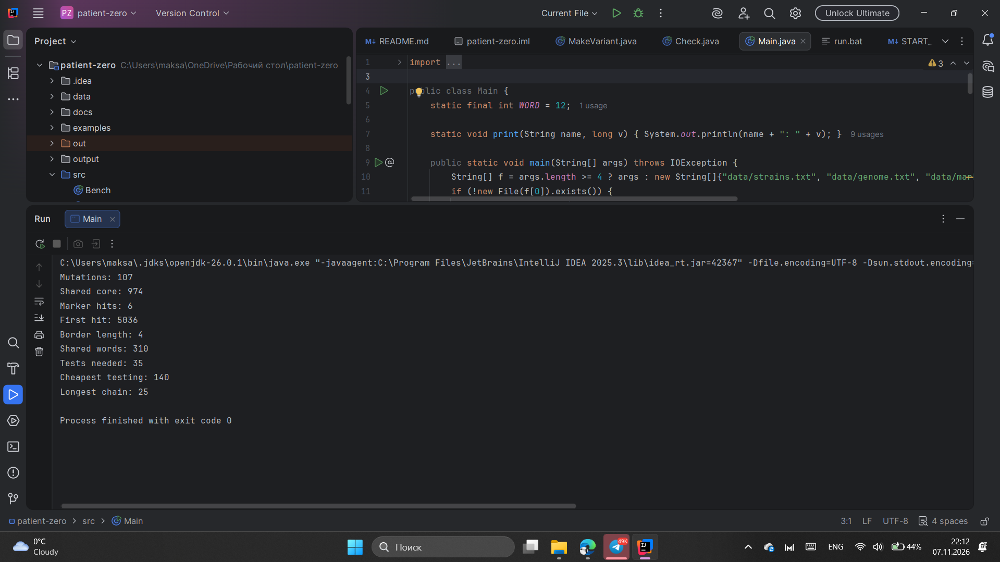
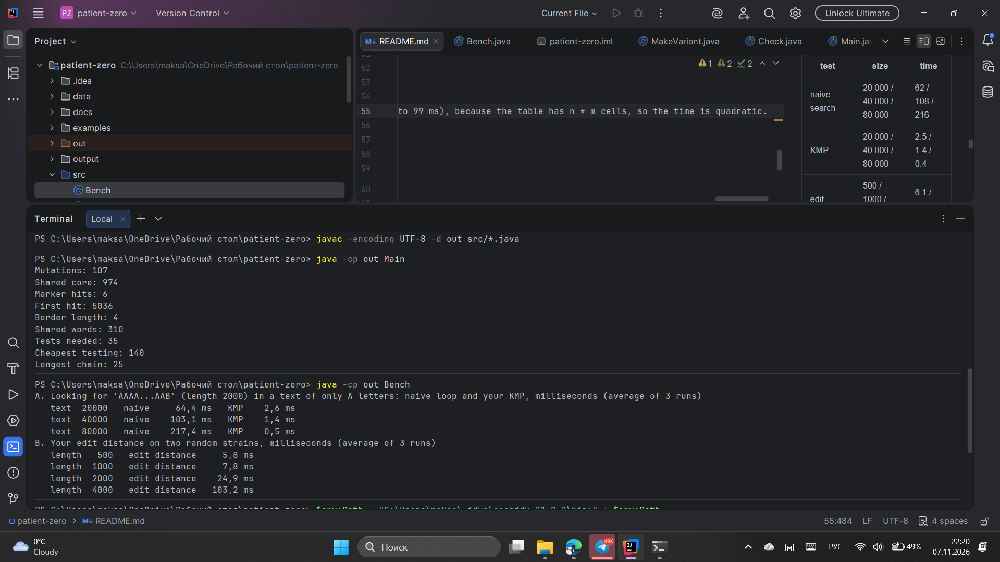

# Assignment 4. Patient Zero

Student ID: 253949  
Name:Maksat Nauanuy  
Group: SE - 2512

This file is the report. Fill it in as you go. How to start: `START_HERE.md`. The task: `docs/Assignment4.pdf`.

## Program output

The 9 lines your program prints on your data (`java -cp out Main`):

    Mutations:
    Shared core:
    Marker hits:
    First hit:
    Border length:
    Shared words:
    Tests needed:
    Cheapest testing:
    Longest chain:

My outbreak report (a screenshot of `output/outbreak.html`):

## Timing (Mission 7)

Milliseconds, average of 3 runs, from `java -cp out Bench`.

| test | size | time |
|---|---|---|
| naive search | 20 000 / 40 000 / 80 000 | 62 / 108 / 216 |
| KMP | 20 000 / 40 000 / 80 000 | 2.5 / 1.4 / 0.4 |
| edit distance | 500 / 1000 / 2000 / 4000 | 6.1 / 6.8 / 24 / 99 |

When the text becomes twice as long, the naive search takes about twice as much time (62, 108, 216 ms), because it compares the long pattern at every position (O(n * m)). KMP stays at a few milliseconds, because the text pointer never goes back and every letter is read once (O(n + m)); the tiny numbers are only measurement noise. The edit distance grows about 4 times when the length doubles (2000 to 4000: 24 to 99 ms), because the table has n * m cells, so the time is quadratic.

